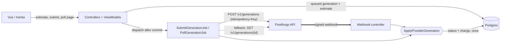

# Pixelforge Studio

## Overview

Signed-in users generate images through the Pixelforge API. They see the estimated cost before submitting and are
charged Pixelforge's actual cost plus a 25% markup, exactly once; failed generations are free. The history updates live.

Stack: Laravel 13, PHP 8.5, PostgreSQL 17, Redis (Laravel Valkey in production), Inertia v3 + Vue 3 + TypeScript +
Tailwind 4, Docker Compose locally, Laravel Cloud in production.
Live: https://pixelforge-studio-production-nbzjkg.laravel.cloud (demo credentials are in the submission form).

Decisions, data model and milestones: [docs/SPEC.md](docs/SPEC.md).

## How it works



1. The server validates the request, recomputes the estimate, stores a `queued` generation and queues the submit.
2. The job calls Pixelforge with our generation id as `Idempotency-Key`, so retries never create a second image.
3. A signed webhook (verified on the raw body, deduplicated by event id) or a polling fallback delivers the result.
4. Both go through `ApplyProviderGeneration`, which locks the row, only moves the status forward and charges once.
5. The page polls its own props only while a generation is in progress.

## Billing rules

- Amounts are integer nanodollars wrapped in a `Money` value object; no floats anywhere.
- Estimate: computed on the server from the cached `GET /v1/pricing` table, as min, typical and max. The client never
  sends or computes an amount.
- Actual cost: Σ tokens × rate, from the `usage` and the `rates` Pixelforge returns on the generation.
- Charge: provider cost × 1.25, rounded up to the nanodollar, per generation.
- Display: min rounded down, typical half-up, max up, actual half-up; the exact 9-decimal value is always sent too.
- Failed generations cost nothing. A generation is marked failed only when Pixelforge says nothing was created.

## How to run

Requires Docker, Node 22 and an [ngrok](https://ngrok.com) static domain for webhooks.

```bash
git clone https://github.com/robsonfgomes/pixelforge-studio.git && cd pixelforge-studio
cp .env.example .env    # set PIXELFORGE_API_KEY and PIXELFORGE_WEBHOOK_SECRET
docker compose up -d --build
docker compose exec app composer install
docker compose exec app php artisan key:generate
docker compose exec app php artisan migrate
npm ci
npm run build           # or npm run dev while developing
ngrok http --url=<your-static-domain> 8000
```

Open http://localhost:8000 and register. In the Pixelforge dashboard, point the key's webhook URL to
`https://<your-static-domain>/webhooks/pixelforge`. The `worker` service processes the queue.

## Tests

```bash
docker compose exec app php artisan test --compact
```

PHPUnit on a separate `pixelforge_testing` database. Tests never call the real API (`Http::fake()` and
`FakePixelforgeApi`); money tests use the worked examples from the Pixelforge docs.

Production check against `GET /v1/usage` (succeeded generations of all users, per UTC day of completion):

| Day (UTC) | Generations | Text in | Image in | Output | Reasoning | Our cost (USD) | Pixelforge (USD) | Diff |
|---|---|---|---|---|---|---|---|---|
| 2026-11-21 | 1 | 6 | 0 | 1,100 | 1,890 | 0.067655000 | 0.067655000 | 0 |
| 2026-11-22 | 15 | 136 | 765 | 12,560 | 9,699 | 0.631967500 | 0.631967500 | 0 |

Retry backoff, measured with `[overloaded]` (Pixelforge always busy) over the 10-minute submit window:

| | Wait between attempts | Attempts |
|---|---|---|
| Before | `Retry-After` only (2 s) | 201 |
| After | longer of `Retry-After` and 2, 4, 8 … 60 s, plus 0–20% jitter | 14 |

## Decisions

- Integer nanodollars: per-token rates and the markup need exact sub-cent amounts; floats would drift.
- Our generation id as `Idempotency-Key` and `metadata.generation_id`: retries and early webhooks are safe.
- Webhook and polling share one Action with a row lock: whichever arrives first wins, the charge happens once.
- Uncertain outcomes (timeouts, 5xx) retry with the same key and are never marked failed: the image may exist.
- Backoff grows per attempt, capped at 60 s (20 s for the concurrency limit): Pixelforge's docs ask for it.
- Domain-oriented `app/` (Laravel Beyond CRUD): money and provider rules stay out of controllers and jobs.
- Polling props only while something is in progress: no WebSockets needed for a few concurrent generations.
- Laravel Cloud managed queue: workers scale with queued work and restart on deploy.

## Where I corrected the agent

All entries: [docs/AGENT_CORRECTIONS.md](docs/AGENT_CORRECTIONS.md). The most relevant:

- Retries obeyed only `Retry-After` (201 attempts in 10 minutes) → a backoff that grows per attempt, as the docs ask.
- The polling chain had no uniqueness guard → one chain per generation, started only by the run that recorded the 202.
- External calls could run inside a transaction or a row lock → call Pixelforge first, then lock, re-read and apply.
- A crash between recording the 202 and dispatching the poll left no fallback for lost webhooks → retries restart it.
- Reference images stayed after a submission → cleared, since each one adds cost the next generation would inherit.

## Left out and next steps

- Balances (stretch): a credit ledger that reserves the max estimate on creation and settles to the actual cost.
- Admin report (stretch): per UTC day and per user, charges and provider cost compared with `GET /v1/usage`.
- Known risk: a generation Pixelforge billed but that never reaches a final state here; a sweep by
  `metadata.generation_id` would reconcile it.
- "Check status" action on a generation whose polling gave up.
- Copy images to object storage: Pixelforge URLs expire after 24 hours.
- Pagination and search in the history; a per-user limit on generations in progress.
- WebSockets (Reverb) instead of polling; alerts on failed jobs (Sentry or Nightwatch).
