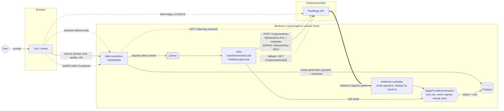

# SPEC: Pixelforge Studio

Task: `docs/TASK.md`. Provider reference: `docs/PIXELFORGE_API.md`. Rules for working on this repo: `CLAUDE.md`.

## Overview

Signed-in users write a prompt, pick an aspect ratio, a quality and up to 4 reference image URLs, see what it will
cost, and generate an image through Pixelforge. Generations are asynchronous: the app submits them from a queue,
learns the result from signed webhooks (with polling as a fallback) and shows live status in a history next to the
composer. Users pay Pixelforge's cost plus 25%. The estimate shown up front is a range; the actual charge is recorded
once, when the generation succeeds. Failed generations are free.

## Flow

1. **Request** (web): validate, recompute the estimate on the server, create the generation (`queued`, estimate,
   price table used), dispatch `SubmitGenerationJob` after commit, redirect to the page.
2. **Submit** (`SubmitGenerationJob` → `SubmitGeneration`): `POST /v1/generations` with `Idempotency-Key` and
   `metadata.generation_id` = our id. On 202, save the Pixelforge id and `submitted_at`, then dispatch
   `PollGenerationJob` with a 45s delay. On 429/503, release with `Retry-After`. On a definitive error, mark `failed`
   ($0).
3. **Webhook** (`PixelforgeWebhookController`): verify the signature, record the event (unique event id), apply the
   generation object through `ApplyProviderGeneration`, answer 204. Duplicates answer 204 with no effect.
4. **Apply** (`ApplyProviderGeneration`): lock the row; ignore if already final; move the status forward; on
   `succeeded`, record usage, rates, provider cost and charge exactly once; on `failed`, record the error, charge $0.
5. **Poll** (`PollGenerationJob`): stop if already final; otherwise `GET /v1/generations/{id}` and apply it through the
   same Action; reschedule with growing delays until final or out of attempts.
6. **Display**: the page polls its own props (`generations`, `hasInProgress`) every 2.5s only while something is in
   progress.

## Architecture

Domain-oriented (*Laravel Beyond CRUD*) inside `app/`. See `CLAUDE.md` for the rules of each layer.



Legend: solid = main flow · dashed = fallback / read-only · bold = push from Pixelforge.

### Folder structure

```
app/
├── Domain/
│   ├── Generations/
│   │   ├── Actions/        CreateGeneration, SubmitGeneration, ApplyProviderGeneration, RecordWebhookEvent
│   │   ├── Data/           GenerationRequestData, ProviderGenerationData, GenerationUsageData
│   │   ├── Enums/          GenerationStatus, ImageSize, ImageQuality
│   │   ├── Exceptions/
│   │   ├── Models/         Generation, WebhookEvent
│   │   └── QueryBuilders/  GenerationQueryBuilder
│   ├── Pricing/
│   │   ├── Actions/        GetPriceTable (cache + last-known fallback)
│   │   ├── Data/           PriceTable, TokenCounts, CostEstimate
│   │   ├── ValueObjects/   Money
│   │   ├── Casts/          MoneyCast
│   │   └── PricingCalculator.php
│   ├── Credits/            (M6) Actions, Enums, Exceptions, Models, QueryBuilders
│   └── Reporting/          (M7) Actions, Data
├── Integrations/Pixelforge/
│   ├── PixelforgeApi.php           contract: pricing(), createGeneration(), retrieveGeneration(), usage() (M7)
│   ├── HttpPixelforgeClient.php
│   ├── WebhookSignature.php
│   └── Exceptions/                 PixelforgeRateLimited, PixelforgeOverloaded, PixelforgeRejected,
│                                   PixelforgeUnavailable
├── Http/
│   ├── Controllers/        GenerationController, GenerationEstimateController, PixelforgeWebhookController,
│   │                       (M6) CreditPurchaseController, (M7) Admin/ReportController
│   ├── Requests/           StoreGenerationRequest, EstimateGenerationRequest
│   ├── Resources/          GenerationResource, CostEstimateResource
│   └── ViewModels/         GenerationPageViewModel, (M7) AdminReportViewModel
└── Jobs/                   SubmitGenerationJob, PollGenerationJob
tests/Fakes/FakePixelforgeApi.php
```

## Decisions

### Product and UX

- One page, inspired by PromptEdit's own image tool: composer on the left, history on the right, dark theme.
- Aspect ratio 1:1 / 3:2 / 2:3 maps to `1024x1024` / `1536x1024` / `1024x1536`. Quality low / medium / high.
  The UI preselects 1:1 and medium; we always send both to Pixelforge.
- Reference images are URLs (max 4, http/https), not uploads: Pixelforge never downloads them.
- Users can start several generations in a row; each appears at the top of the history as `queued`. No per-user
  in-flight limit (next steps).
- Estimate box: "**~$0.3929** · at most $0.4476", plus "The final cost depends on processing. Failed generations
  are free." Updated by a debounced (300 ms) call to the estimate endpoint; validation errors show inline instead.
- If no price table is available (never fetched and `/v1/pricing` fails), the estimate shows "Estimate unavailable"
  and Generate is disabled; the server rejects the request too.
- History card: prompt, size, quality, status badge, estimated and actual cost, the image, timestamps. A `queued`
  generation without `submitted_at` shows "Waiting to submit" (or "Retrying…"). Failed cards show a friendly
  reason and "You were not charged". After `image_url_expires_at` the image becomes an "Image expired" placeholder.
- Amounts show 4 decimals; the exact amount (9 decimals) is in a tooltip.
- Registration is open (no email verification, 2FA or passkeys). A seeded demo user exists and is an admin.

### Money

- Amounts are integer nanodollars (`bigint`) wrapped in `Money`. No floats anywhere.
- Provider cost = Σ tokens × rate (rates are USD per 1M tokens, so 1 token at $1.00/1M = 1,000 nanodollars).
- Charge = provider cost × 5/4, rounded up to the nanodollar (at most $0.000000001 in our favor), on estimates and
  actual costs alike. Failed generations: charge 0.
- Actual cost uses the `usage` and `rates` of the generation itself (fixed at creation), so it matches
  `GET /v1/usage`. Estimates use `GET /v1/pricing`.
- Estimate tokens:

  | Type | Min | Typical | Max |
  |---|---|---|---|
  | Text (`e = ceil(chars / 4)`, Unicode chars) | `floor(e × 0.85)` | `e` | `ceil(e × 1.15)` |
  | Image | 765 × refs | same | same |
  | Output | table[quality][size] | same | same |
  | Reasoning | range min | midpoint | range max |

- The generation stores the typical and max charge it showed, and the price table it used.
- Price table cache: TTL `PIXELFORGE_PRICING_CACHE_TTL` (default 3600 s). Invalidated when a create response returns
  rates different from the cached ones. The last table fetched is kept with no TTL as the fallback.

### Pixelforge

- Generation id: UUIDv7 (`HasUuids`), also used as `Idempotency-Key` and `metadata.generation_id`.
- HTTP client timeouts: 10 s to connect, 30 s per request.
- `SubmitGenerationJob`: `ShouldBeUnique` by generation id, `retryUntil()` 10 minutes, released with the
  `Retry-After` header on 429/503 (exponential backoff capped at 60 s when the header is missing).
- When the 10 minutes run out after "nothing was created" answers (429/503), the generation is `failed` ($0):
  "Pixelforge is busy. You were not charged. Please try again."
- Definitive errors → `failed` ($0) with a friendly message: `content_policy_violation` ("Prompt rejected by the
  content policy"), `daily_limit_exceeded` ("Daily capacity reached, try again after 00:00 UTC"),
  `validation_failed` / `idempotency_key_reused` / `invalid_api_key` (generic message, logged as errors: they mean a
  bug or a misconfiguration).
- Uncertain outcomes (timeout, connection error, unexpected 5xx): keep retrying with the same `Idempotency-Key`
  (replays are free and don't count against the limits) for up to 1 hour, then leave the generation `queued`, log an
  error and stop. Never mark it `failed`: Pixelforge may have created and billed it. The card shows "Taking longer
  than expected".
- No concurrency semaphore on our side: we rely on `concurrency_limit_exceeded` + `Retry-After: 5` (limits are per
  account and shared with the local key).
- `PollGenerationJob`: delays 45 s, 1, 2, 5, 10, 10, 10, 10 minutes (8 attempts). It stops as soon as the generation
  is final, releases on 429 and, when out of attempts, logs a warning and keeps the last status.
- Webhook route `POST /webhooks/pixelforge`: no auth, no CSRF, no throttle. Signature: HMAC-SHA256 of
  `"<t>.<raw body>"`, `hash_equals`, `|now - t| <= 300` s, otherwise 400. Event id unique in `webhook_events`
  (duplicate → 204, no effect). `ping` → 204. Unknown generation → 204 and a log line. The event insert and the
  state change happen in one transaction, inline (fast enough for the 10 s limit).
- Matching: by `metadata.generation_id` (works even when the webhook beats the create response), then by
  Pixelforge id.
- Status moves only forward: `queued → processing → succeeded | failed`, and `queued → succeeded | failed` is
  allowed (a `processing` event may be lost or late). Final states never change.
- `completed_at` comes from Pixelforge, not from when we received it (the report groups by UTC completion day).
- Images are not downloaded (the task allows them to expire).

### Credits (M6)

- New users start at $0.00 and see "Buy credits to start". "Buy credits" offers fixed packs of $5, $10 and $25 (a
  fake purchase). The demo user starts with $10.00.
- Creating a generation reserves its max estimated charge; success settles to the actual charge; failure releases
  the whole reservation. Generate is blocked when the available balance is below the max estimate.

### Infrastructure

- Local: Docker Compose (`app`, `worker` with `queue:listen`, `postgres:17`, `redis:8`); Vite runs on the host;
  webhooks reach the app through an ngrok static domain.
- Production: Laravel Cloud (Flex compute, Serverless Postgres 17 "Dev", Laravel Valkey Flex, managed queue). No
  scheduler: polling uses delayed jobs.
- Redis/Valkey holds cache, sessions, locks and rate limiters, with retry and backoff configured on the connection
  (Valkey can restart during maintenance). Queue: Redis locally, Cloud managed queue in production.
- Throttles (per user, configurable): generate 10/min, estimate 60/min.
- CI: GitHub Actions runs the test suite on PostgreSQL 17 and the linters on every push.

## Data model

All amounts are `bigint` nanodollars (cast to `Money`).

**users** (starter kit) + `is_admin` boolean, default false.

**generations**

| Column | Type | Notes |
|---|---|---|
| `id` | uuid, PK | UUIDv7; also the Idempotency-Key and `metadata.generation_id` |
| `user_id` | FK users | |
| `status` | string | `GenerationStatus` |
| `prompt` | text | |
| `size`, `quality` | string | enums |
| `reference_images` | jsonb | list of URLs |
| `estimate_price_table` | jsonb | price table used for the estimate |
| `estimated_charge`, `estimated_max_charge` | bigint | what the user saw |
| `pixelforge_id` | string, nullable, unique | `gen_…` |
| `rates` | jsonb, nullable | from Pixelforge, fixed at creation |
| `input_text_tokens`, `input_image_tokens`, `output_tokens`, `reasoning_tokens` | integer, nullable | on success |
| `provider_cost`, `charge` | bigint, nullable | set once on success; `charge` = 0 on failure |
| `image_url` | text, nullable | |
| `image_url_expires_at` | timestamp, nullable | |
| `error_code`, `error_message` | string / text, nullable | |
| `submitted_at`, `started_at`, `completed_at` | timestamp, nullable | `completed_at` from Pixelforge |
| `created_at`, `updated_at` | timestamp | |

Indexes: `(user_id, created_at)`, `status`, `completed_at`.

**webhook_events**: `id`, `event_id` (unique), `type`, `generation_id` (nullable FK), `delivery_attempt`,
`payload` (jsonb), `created_at`.

**credit_transactions** (M6): `id`, `user_id`, `generation_id` (nullable), `type` (`purchase`, `reservation`,
`settlement`, `release`), `amount` (signed bigint), `created_at`. Balance = sum of `amount`.

## Milestones

Before M1: CI runs on PostgreSQL (`.github/workflows`), and this SPEC is approved.

**M1 – Money and pricing**
`Money` + `MoneyCast`, `PriceTable`, `PricingCalculator`, `PixelforgeApi::pricing()` + `HttpPixelforgeClient`,
`GetPriceTable` (cache, invalidation, fallback), `config/services.php` entry, estimate endpoint with its request and
throttle.
Tests: the docs' worked examples as expected values (max $0.373875000; usage day $0.169080000; the succeeded
lighthouse example $0.305510000), markup rounding, estimate ranges for each quality/size, Unicode prompt length,
cache hit/miss/fallback, validation.
Manual: `POST /generations/estimate` returns min/typical/max for a sample prompt.

**M2 – Create and submit**
Migrations (`generations`, `webhook_events`, `users.is_admin`), `Generation` model + query builder,
`GenerationStatus`, `CreateGeneration`, `GenerationController@store`, `SubmitGenerationJob` + `SubmitGeneration`,
`PixelforgeApi::createGeneration()`, error mapping, `FakePixelforgeApi`.
Tests: the estimate is recomputed and stored; the job is dispatched after commit; 202 stores the Pixelforge id;
429/503 release with `Retry-After`; each definitive error fails at $0; 10-minute cutoff; uncertain outcomes keep
retrying with the same key; idempotent replay.
Manual: create one generation from tinker or a request; it appears in the Pixelforge dashboard with our metadata.

**M3 – Results: webhook and polling**
`WebhookSignature`, `PixelforgeWebhookController`, `RecordWebhookEvent`, `ApplyProviderGeneration`,
`PollGenerationJob`, `PixelforgeApi::retrieveGeneration()`.
Tests: valid / invalid / expired signature; duplicate event; `processing` after `succeeded`; webhook before the
create response; webhook and poll racing charge once; failed is free; polling stops when final and gives up without
failing.
Manual: through the tunnel, `[duplicate]`, `[fail]`, `[slow]` and a dashboard resend all end in the right state with
one charge.

**M4 – Page**
`GenerationPageViewModel` (lazy props), `GenerationResource`, the Vue page (composer, estimate, history, cards,
empty and error states), `usePoll`, Wayfinder routes, nav and branding.
Tests: page props for a user (only their generations, `hasInProgress`), partial reload returns only the requested
props.
Manual: every keyword (`[blocked]`, `[overloaded]`, `[fail]`, `[slow]`, `[duplicate]`, `[succeed]`) shows a clear
state; four generations at once show one waiting for a slot.

**M5 – Ship**
Redis retry/backoff config, demo user seeder, deploy to Laravel Cloud, keyword scenarios on production, compare the
recorded provider costs with `GET /v1/usage`, README, leave a few generations.
Manual: the production numbers match the Pixelforge dashboard for the production key.

**M6 – Stretch: balances**
`credit_transactions`, `PurchaseCredits`, `ReserveCredits` (in `CreateGeneration`, locking the user row),
`SettleCharge` / `ReleaseReservation` (in `ApplyProviderGeneration`), balance in the header and "Buy credits",
Generate blocked when the balance is below the max estimate.
Tests: reservation, settlement to the actual charge, release on failure, concurrent requests cannot overspend.

**M7 – Stretch: admin report**
Admin-only page (Gate on `is_admin`): per UTC completion day and per user, generations, credit spend (charges),
provider cost and profit, plus Pixelforge's `cost_usd` from `GET /v1/usage` for the same days, flagging any
difference.
Tests: grouping by completion day in UTC, totals, access control, comparison against a faked usage response.

## Optional / next steps

- "Check status" button on a generation whose polling gave up.
- Per-user limit on generations in progress.
- Download images to object storage to keep them after 24 hours.
- WebSockets (Reverb) instead of polling the page.
- A shared concurrency semaphore for Pixelforge's 3-slot limit.
- Alerts on failed jobs and on report mismatches (Sentry or Nightwatch).
