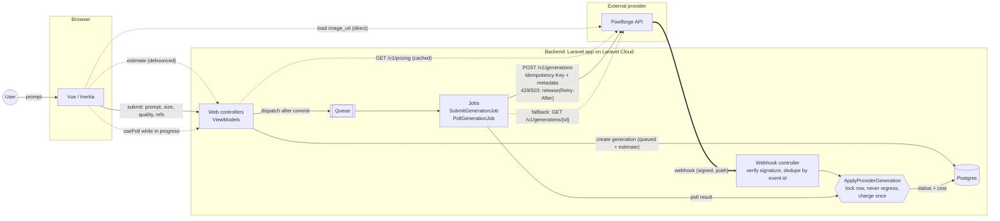

# SPEC: Pixelforge Studio

Task: `docs/TASK.md`. Provider reference: `docs/PIXELFORGE_API.md`. Rules for working on this repo: `CLAUDE.md`.

## Overview

Signed-in users write a prompt, pick an aspect ratio, a quality and up to 4 reference image URLs, see what it will
cost, and generate an image through Pixelforge. Generations are asynchronous: the app submits them from a queue,
learns the result from signed webhooks (with polling as a fallback) and shows live status in a history next to the
composer. Users pay Pixelforge's cost plus 25%. The estimate shown up front is a range; the actual charge is recorded
once, when the generation succeeds. Failed generations are free.

## Scope

- In scope: every required feature of the task (M1–M5), working, tested and deployed.
- Out of scope (decided on 2026-11-22, for lack of time): both stretch goals, M6 (balances) and M7 (admin report).
  Their design below stays as the planned reference, and the README lists each one under "Left out and next steps":
  - Balances: a credit ledger (`credit_transactions`) that reserves the max estimated charge when a generation is
    created, settles to the actual charge on success and releases the reservation on failure.
  - Admin report: per UTC completion day and per user, charges, provider cost and profit, compared with
    `GET /v1/usage` for the same days, flagging any difference.

## Flow

1. **Request** (web): validate, recompute the estimate on the server, create the generation (`queued`, estimate,
   price table used), dispatch `SubmitGenerationJob` after commit, redirect to the page (`back()` until M4).
2. **Submit** (`SubmitGenerationJob` → `SubmitGeneration`): `POST /v1/generations` with `Idempotency-Key` and
   `metadata.generation_id` = our id. On 202, save the Pixelforge id, `rates` and `submitted_at` under the row lock,
   apply the returned object through `ApplyProviderGeneration` (a replay may already be final) and, when this run set
   `submitted_at` and the generation is not final, dispatch poll attempt 1 with a 45s delay. On 429/503, release with
   `Retry-After`. On a definitive error, mark `failed` ($0). On an uncertain outcome, keep retrying with the same
   key.
3. **Webhook** (`PixelforgeWebhookController`): verify the signature, record the event (unique event id), apply the
   generation object through `ApplyProviderGeneration`, answer 204. Duplicates answer 204 with no effect.
4. **Apply** (`ApplyProviderGeneration`): lock the row; ignore if already final; move the status forward; on
   `succeeded`, record usage, rates, provider cost and charge exactly once; on `failed`, record the error, charge $0.
5. **Poll** (`PollGenerationJob`): stop if already final; otherwise `GET /v1/generations/{id}` and apply it through the
   same Action; dispatch the next attempt with a growing delay until final or out of attempts.
6. **Display**: the page polls its own props (`generations`, `hasInProgress`) every 2.5s only while something is in
   progress.

## Architecture

Domain-oriented (*Laravel Beyond CRUD*) inside `app/`. See `CLAUDE.md` for the rules of each layer.



Legend: solid = main flow · dashed = fallback / read-only · bold = push from Pixelforge.

### Folder structure

```
app/
├── Domain/
│   ├── Generations/
│   │   ├── Actions/        CreateGeneration, SubmitGeneration, FailGeneration, ApplyProviderGeneration,
│   │   │                   RecordWebhookEvent
│   │   ├── Data/           GenerationRequestData, ProviderGenerationData, WebhookEventData
│   │   ├── Enums/          GenerationStatus, GenerationFailureReason, ImageSize, ImageQuality
│   │   ├── Exceptions/     InvalidProviderGeneration, InvalidWebhookEvent
│   │   ├── Models/         Generation, WebhookEvent
│   │   └── QueryBuilders/  GenerationQueryBuilder (forUser, inProgress, recentlyActive)
│   ├── Pricing/
│   │   ├── Actions/        GetPriceTable (cache + last-known fallback), InvalidatePriceTable
│   │   ├── Data/           PriceTableData, TokenRatesData, TokenCountsData, CostEstimateData
│   │   ├── Enums/          DisplayRounding
│   │   ├── Exceptions/     UnsupportedRatePrecision, PriceTableUnavailable
│   │   ├── ValueObjects/   Money
│   │   ├── Casts/          MoneyCast
│   │   └── PricingCalculator.php
│   ├── Credits/            (M6) Actions, Enums, Exceptions, Models, QueryBuilders
│   └── Reporting/          (M7) Actions, Data
├── Integrations/Pixelforge/
│   ├── PixelforgeApi.php           contract: pricing(), createGeneration(), retrieveGeneration(), usage() (M7)
│   ├── HttpPixelforgeClient.php
│   ├── WebhookSignature.php
│   └── Exceptions/                 PixelforgeRateLimited, PixelforgeOverloaded, PixelforgeRejected,
│                                   PixelforgeUnavailable, InvalidPixelforgeSignature, PixelforgeWebhookSecretMissing
├── Http/
│   ├── Concerns/           FormatsMoney (exact + display value; used by resources and view models)
│   ├── Controllers/        LandingController, GenerationController, GenerationEstimateController,
│   │                       PixelforgeWebhookController, (M6) CreditPurchaseController, (M7) Admin/ReportController
│   ├── Requests/           StoreGenerationRequest, EstimateGenerationRequest, Concerns/ValidatesGenerationRequests
│   ├── Resources/          GenerationResource, CostEstimateResource
│   └── ViewModels/         LandingPageViewModel, GenerationPageViewModel, (M7) AdminReportViewModel
└── Jobs/                   SubmitGenerationJob, PollGenerationJob
tests/Fakes/FakePixelforgeApi.php
```

Entries marked (M6) or (M7) belong to the out-of-scope stretch goals and don't exist.

Starter kit code (`app/Concerns`, `app/Actions/Fortify`, the settings controllers and requests) stays as it is and is
exempt from these folder rules.

## Decisions

### Product and UX

- One page, `GET /generations` (`generations.index`), inspired by PromptEdit's own image tool: we follow its
  patterns, not its brand (accent color, logo and copy are ours). It is Fortify's `home`, so login and registration
  land on it; the starter kit's Dashboard (route, page, test and nav item) is removed. The app keeps the name
  "Pixelforge Studio" (the no-provider rule applies to error copy, not to the app name). The generations page and the
  Settings screens use the starter kit's header layout, not the sidebar one: there is no side menu, and the starter
  kit's Repository, Documentation and search links go away.
- Dark theme by default when the user hasn't picked one; the starter kit's Appearance setting keeps working.
- Brand: logo, name, tab title and favicon (`favicon.svg`, `favicon.ico`, `apple-touch-icon.png`, drawn from the
  logo) are Pixelforge Studio's on every screen, including login, registration, password recovery and Settings. No
  PromptEdit or Laravel branding.
- Landing at `/` (`home`), short, for guests and signed-in users, same dark theme and accent color, no stock images
  (one simple decorative element of our own in CSS/SVG):
  1. Header: logo and "Pixelforge Studio" on the left; "Log in" and "Create account" for guests, "Open studio" for
     signed-in users, on the right.
  2. Hero: a short title, one sentence about the app and the main button ("Start creating" → registration; signed
     in: "Open studio" → `generations.index`).
  3. "How it works" in 3 steps: see the cost before generating; generation in the background with live status; pay
     only for real usage.
  4. "Transparent pricing": the rule in plain words (the image provider's cost + the markup, the estimate as a
     range, the real charge recorded once, failures free) and an example table for low / medium / high at 1:1 showing
     "~typical · at most max", for a 200-character prompt and no reference images, plus what each reference image
     adds. Every value comes from the server (`PricingCalculator` and the current price table, through
     `LandingPageViewModel`), never written by hand. The table is a deferred prop (`Inertia::defer`), so a slow price
     table never delays the landing; when no price table can be obtained (neither cached nor last known) it resolves
     to "unavailable" and the section shows only the rule, with no table and no endless skeleton.
  5. Footer: a link to the GitHub repository and the stack in one line.
- Layout:
  - A top bar: logo and name on the left; the user menu (Settings, Log out) on the right. In M6 (out of scope), the
    balance chip with a "+" (Buy credits) button goes next to the user menu.
  - Below it, two columns at the full height of the screen: the composer on the left and the history on the right,
    taking the rest. On narrow (mobile) screens they stack: composer on top, history below.
  - Composer panel on the left, fixed width, with its own scroll. Sections with small uppercase labels (REFERENCE
    IMAGES, PROMPT, ASPECT RATIO, QUALITY); counters on the references (0/4) and the prompt (0/4000). Aspect ratio
    (with an icon of the shape) and quality side by side, as selects.
  - A footer pinned to the bottom of the panel, with no top border and a background one tone above the panel's (it
    separates the footer from the content scrolling above it): the estimate (or its state) on the left; a large
    Generate button on the right with the Ctrl/⌘ + Enter hint. On md and up the page has a fixed height, so in a short
    window the panel scrolls on its own and the footer stays visible. The shortcut works and follows the same rules
    as the button. In M6 (out of scope) the balance goes under the estimate, in a warning color when it isn't enough.
  - The area on the right: a plain title and the history as cards; a centered empty state with an icon, a title
    and one line of guidance.
  - Out of scope: model picker, video/audio tabs, upscale, number of generations, projects, search and the
    grid/list toggle (the last two are next steps).
- Submitting past our own throttle (429) shows "You are generating too fast. Please wait a moment and try again."
  in the composer footer instead of an error page.
- Generate is disabled while submitting, while the prompt is empty (no estimate request either: "Enter a prompt to see
  the cost"), while the estimate is invalid or unavailable, and until the estimate for the current input has arrived
  (debounce and request in flight), so the user always saw the price of what they send. Once the server accepts the
  submission, the prompt and the reference images are cleared (each reference adds cost, so the next generation must
  not inherit it unnoticed); aspect ratio and quality stay, as preferences that usually repeat. A rejected submission
  keeps the values and shows the errors. Enabled buttons show the pointer cursor.
- Aspect ratio 1:1 / 3:2 / 2:3 maps to `1024x1024` / `1536x1024` / `1024x1536`. Quality low / medium / high.
  The UI preselects 1:1 and medium; we always send both to Pixelforge. The UI does the aspect ratio mapping: our
  endpoints receive the Pixelforge size (`1024x1024`), validated by the `ImageSize` enum.
- Reference images are URLs (max 4, http/https), not uploads: Pixelforge never downloads them.
- Users can start several generations in a row; each appears at the top of the history as `queued`. No per-user
  in-flight limit (next steps).
- Estimate box: "**~$0.3929** · at most $0.4476", plus "The final cost depends on processing. Failed generations
  are free." Updated by a debounced (300 ms) call to the estimate endpoint; validation errors show inline instead.
  Only the latest response may update the box: every change cancels the request in flight before scheduling the
  next one (`useHttp` doesn't cancel the previous request by itself). 503 and 429 show "Estimate unavailable".
- If no price table is available (never fetched and `/v1/pricing` fails), the estimate shows "Estimate unavailable"
  and Generate is disabled; the server rejects the request too.
- Estimate endpoint: `POST /generations/estimate`, signed-in users only, `estimate` throttle, the same validation as
  generating (prompt up to 4,000 Unicode characters, size, quality, up to 4 http/https URLs). It returns
  `data.min`, `data.typical` and `data.max`, each `{amount, display}`; with no price table it answers 503
  "Estimate unavailable".
- History: the user's 50 most recent generations, newest first (pagination or infinite scroll are next steps).
- History card: prompt, size, quality, status badge, estimated and actual cost, the image, timestamps. The image frame
  has the generation's aspect ratio (`aspect-square` for 1:1, 3:2 and 2:3 otherwise) and the image shows whole
  (`object-contain`), so the caption Pixelforge writes on it stays visible. A failed card has no image frame: a compact
  strip with the icon, the friendly reason and "You were not charged", and "Charged" reads "Not charged".
  Cards align to the top of their grid row and keep their own height, so a failed card doesn't stretch to match an
  image card beside it.
  `GenerationResource` sends `submissionState`: `waiting` (queued, `submit_attempts` 0), `waiting_for_slot` (queued, the
  last attempt hit `concurrency_limit_exceeded`: "Waiting for a free slot"), `retrying` (queued, any other answer) or
  `taking_longer` (not final, and either uncertain for longer than the uncertain-outcome window or older than the page
  polling window). It receives both windows through its constructor, from the view model. It also sends
  `durationSeconds` (from our creation to Pixelforge's completion, so it includes any wait to be submitted), shown as
  "Completed in 18 s" or "Failed after 12 s" next to the date. Failed cards show the friendly reason (`failureMessage`)
  and "You were not charged". The server sends `imageUrlExpiresAt`; the card shows an "Image expired" placeholder once
  it has passed or when the image fails to load.
- The page polls `generations` and `hasInProgress` every 2.5 s (`usePoll`, `mode: 'rest'`, started and stopped by
  `hasInProgress`). `hasInProgress` uses `recentlyActive()`: not final and created within the page polling window
  (`config/generations.php`, 120 minutes). `inProgress()` keeps its domain meaning (not final).
- Amounts show 4 decimals; the exact amount (9 decimals) is in a tooltip. Every amount the UI shows (estimates,
  history costs) is sent by the server as the exact value (9-decimal string) plus a formatted display value; the
  frontend never rounds. Display rounding: min down, typical half-up, max up, actual cost half-up (the exact value
  stays in the tooltip).
- Registration is open (no email verification, 2FA or passkeys). A seeded demo user exists and is an admin.

### Money

- Amounts are integer nanodollars (`bigint`) wrapped in `Money`. No floats anywhere. `Money` accepts negative
  amounts (M6 needs signed amounts); rounding up is always towards +∞.
- Provider cost = Σ tokens × rate (rates are USD per 1M tokens, so 1 token at $1.00/1M = 1,000 nanodollars).
- Rates become integer nanodollars per token at the edge (`"12.50"` → 12,500). A rate with more than 3 decimals
  can't be exact in nanodollars and throws `UnsupportedRatePrecision` instead of rounding.
- `text_token_variance` arrives as a JSON number (`0.15`); it becomes integer basis points (1,500) at the edge.
- Charge = provider cost × (100 + markup percent) / 100, rounded up to the nanodollar (at most $0.000000001 in our
  favor), on estimates and actual costs alike. Markup is 25% (`config/generations.php`). Failed generations:
  charge 0.
- Actual cost uses the `usage` and `rates` of the generation itself (fixed at creation), so it matches
  `GET /v1/usage`. Estimates use `GET /v1/pricing`.
- Estimate tokens:

  | Type | Min | Typical | Max |
  |---|---|---|---|
  | Text (`e = ceil(chars / 4)`, Unicode chars) | `floor(e × (10⁴ − v) / 10⁴)` | `e` | `ceil(e × (10⁴ + v) / 10⁴)` |
  | Image | 765 × refs | same | same |
  | Output | table[quality][size] | same | same |
  | Reasoning | range min | midpoint, rounded up | range max |

  `v` is the variance in basis points (1,500); every step is integer arithmetic. The 4 and the 765 come from the
  price table (`characters_per_text_token`, `per_reference_image`), not from constants.
- The generation stores the typical and max charge it showed, and the price table it used.
- Price table cache: TTL `PIXELFORGE_PRICING_CACHE_TTL` (default 3600 s). Invalidated when a create response returns
  rates different from the cached ones: M1 builds the invalidation, M2 calls it. The last table fetched is kept with
  no TTL as the fallback.

### Pixelforge

- Generation id: UUIDv7 (`HasUuids`), also used as `Idempotency-Key` and `metadata.generation_id`.
- HTTP client timeouts: 10 s to connect, 30 s per request.
- `SubmitGenerationJob`: `ShouldBeUnique` by generation id (`UniqueFor` 70 minutes, so a dead worker can't keep the
  lock), `retryUntil()` = creation + the uncertain-outcome window (60 minutes); the 10-minute submit window is checked
  inside the job. After a 429/503 or an uncertain outcome it is released for the longer of `Retry-After` and a
  backoff that doubles on each attempt (2, 4, 8, 16, 32, 60 s; capped at 60 s, or 20 s for
  `concurrency_limit_exceeded` so a generation doesn't wait long after a slot frees), plus 0-20% jitter so refused
  generations don't retry in the same second. Pixelforge asks to back off further each time, not only to obey
  `Retry-After`. The base, caps and jitter live in `config/generations.php` (`retry_backoff`); both jobs share them
  through the `BacksOffFromPixelforge` trait.
- Answers are classified as:
  - "Nothing was created": 429 `rate_limit_exceeded` / `concurrency_limit_exceeded`, 503 `overloaded`. Release.
  - Definitive: 400 `content_policy_violation`, 429 `daily_limit_exceeded`, 422 `validation_failed`, 409
    `idempotency_key_reused`, 401 `invalid_api_key`, and any other 4xx. `failed` at $0. Everything except the first
    two is logged as an error: it means a bug or a misconfiguration.
  - Uncertain: timeout, connection error, any 5xx other than `overloaded`, a 202 with an invalid body.
- Every answer other than a 202 increments `submit_attempts`. The first uncertain outcome sets
  `submission_uncertain_at`; from then on every non-202 answer is treated as uncertain until a 202 arrives (a 429
  after a timeout doesn't prove nothing was created).
- When the 10 minutes run out after "nothing was created" answers and no uncertain outcome, the generation is
  `failed` ($0) with our code `pixelforge_busy`.
- Uncertain outcomes keep retrying with the same `Idempotency-Key` (replays are free and don't count against the
  limits) for up to 1 hour, then the generation stays `queued`, an error is logged and the job stops. Never mark it
  `failed`: Pixelforge may have created and billed it.
- Failures store `error_code` (Pixelforge's code, or ours such as `pixelforge_busy`) and `error_message`
  (Pixelforge's original message, or a technical description for our codes), for debugging. No UI copy in the
  database: the friendly text comes from `GenerationFailureReason::fromCode($code)->message()`, applied by
  `GenerationResource` (M4). The copy never names the provider:
  - `content_policy_violation`: "Prompt rejected by the content policy"
  - `daily_limit_exceeded`: "Daily capacity reached, try again after 00:00 UTC"
  - `generation_failed`: "We couldn't create an image for this prompt. Try rewording it."
  - `pixelforge_busy`: "The image service is busy right now. Please try again."
  - `internal_error` and anything else: "Something went wrong while generating. Please try again."
- The card derives its submission state from the columns: `submit_attempts` 0 → "Waiting to submit", more than 0 →
  "Retrying…", uncertain for longer than the uncertain-outcome window → "Taking longer than expected".
- No concurrency semaphore on our side: we rely on `concurrency_limit_exceeded` + `Retry-After: 5` (limits are per
  account and shared with the local key).
- Never call Pixelforge inside a database transaction or while holding a row lock: call the API first, then lock,
  re-read and apply.
- `PollGenerationJob`: delays 45 s, 1, 2, 5, 10, 10, 10, 10 minutes (8 attempts). Each job carries its attempt number
  and, when the generation is still not final, dispatches the next attempt with the next delay. It implements
  `ShouldBeUniqueUntilProcessing` keyed by generation id, so there is never more than one polling chain per
  generation and a running job can dispatch its successor. It stops as soon as the generation is final. A 429
  releases the job for `Retry-After` without spending an attempt (each job has `retryUntil()` 10 minutes for that).
  An uncertain answer (timeout, 5xx) spends an attempt. A 404 `not_found` logs an error and stops without changing
  the status. Out of attempts: log a warning and keep the last status.
- `ApplyProviderGeneration` fills `pixelforge_id` and `rates` when they are empty, but never `submitted_at`: only our
  own create response sets it, so the submit job still finishes its cycle and starts polling when a webhook beats it.
- A retry of `SubmitGeneration` that finds `submitted_at` set and the generation not final dispatches poll attempt 1
  again: the run that recorded the 202 may have died before starting the polling. The poll job's uniqueness keeps it
  to one chain.
- `PollGenerationJob` treats a 503 `overloaded` like a 429 (released with the same `Retry-After` + growing backoff +
  jitter, no polling attempt spent) and retries unexpected errors with `backoff()` 10, 30 and 60 s, within its
  10-minute `retryUntil()`.
- Webhook route `POST /webhooks/pixelforge` lives in `routes/webhooks.php`, loaded by `bootstrap/app.php` with no
  middleware: no auth, no CSRF, no session, no throttle. Signature: HMAC-SHA256 of `"<t>.<raw body>"`, `hash_equals`,
  `|now - t| <= 300` s, otherwise 400. A body that is not a valid event (even with a valid signature) → 400 and an
  error log. No webhook secret configured → 500 and an error log (our misconfiguration, not a bad request). Event id
  unique in `webhook_events` (duplicate → 204, no effect). `ping` → 204. Unknown generation → the event is still
  recorded (so a resend stays a duplicate), 204 and a log line. The event insert and the state change happen in one
  transaction, inline (fast enough for the 10 s limit).
- Matching: by `metadata.generation_id` (works even when the webhook beats the create response), then by
  Pixelforge id.
- Status moves only forward: `queued → processing → succeeded | failed`, and `queued → succeeded | failed` is
  allowed (a `processing` event may be lost or late). Final states never change.
- `completed_at` comes from Pixelforge, not from when we received it (the report groups by UTC completion day).
- Images are not downloaded (the task allows them to expire).
- Known risk: a generation can end without a final state on our side while Pixelforge billed it (the submit job gave
  up after an hour of uncertain outcomes, or polling ran out of attempts with no webhook). Our records then don't
  match `GET /v1/usage` for that day. The M5 cost check catches those days by hand (the out-of-scope M7 report would
  flag them); a "Check status" action or a sweep that matches `GET /v1/generations` by `metadata.generation_id` is a
  next step. The README lists it under "Left out and
  next steps".

### Credits (M6, out of scope: planned design)

- New users start at $0.00 and see "Buy credits to start". "Buy credits" offers fixed packs of $5, $10 and $25 (a
  fake purchase). The demo user starts with $10.00.
- Creating a generation reserves its max estimated charge; success settles to the actual charge; failure releases
  the whole reservation. Generate is blocked when the available balance is below the max estimate.

### Infrastructure

- Local: Docker Compose (`app`, `worker` with `queue:listen`, `postgres:17`, `redis:8`); Vite runs on the host;
  webhooks reach the app through an ngrok static domain.
- Production: Laravel Cloud, environment `pixelforge-studio-production`
  (`https://pixelforge-studio-production-nbzjkg.laravel.cloud`), created in Stage 0 and already tested with the
  skeleton: Flex app, Serverless Postgres 17 (backup preset "Dev"), Laravel Valkey Flex 250 MB, managed queue, all in
  US East (Ohio). No scheduler: polling uses delayed jobs (the managed queue allows delays up to 15 minutes; ours are
  at most 10). We check these resources; we don't create them, except the managed queue, which the CLI check found
  missing and was created in M5: `default`, standard, `mq.flex.256mb`, up to 3 workers, visibility timeout 180 s.
  The worker count doesn't control Pixelforge's limit of 3 generations in progress: a worker is busy only during the
  POST, and the generation keeps running at Pixelforge without holding a worker. That limit is still handled by the
  release with `Retry-After`; the 3 workers are only a cap on jobs running in parallel, enough for our load.
- Production environment variables:
  - Injected by Valkey: `CACHE_STORE`, `SCHEDULE_CACHE_DRIVER`, `REDIS_HOST`, `REDIS_PORT`, `REDIS_SCHEME`,
    `REDIS_USERNAME`, `REDIS_PASSWORD`, `REDIS_CACHE_DB`, `REDIS_PERSISTENT`. Injected by the managed queue:
    `QUEUE_CONNECTION=cloud`. Injected by Postgres: `DB_*`.
  - Set by us in the dashboard: `SESSION_DRIVER=redis`, `APP_MAINTENANCE_DRIVER=cache`,
    `APP_MAINTENANCE_STORE=redis`, `PIXELFORGE_BASE_URL`, `PIXELFORGE_API_KEY` and `PIXELFORGE_WEBHOOK_SECRET` (the
    production key), `PIXELFORGE_PRICING_CACHE_TTL`, `APP_NAME`, `APP_DEBUG=false`, `APP_URL`, `DEMO_USER_PASSWORD`,
    and optionally the throttles. Plain environment variables, not Secrets Manager (they belong to one environment);
    the user types every value; the agent never sees them.
  - The production key's webhook URL is `https://pixelforge-studio-production-nbzjkg.laravel.cloud/webhooks/pixelforge`.
- Cloud operations go through the `cloud` CLI installed globally on the user's machine and authenticated by the user
  (not in `composer.json`). Read-only commands run once the user approves the checks; every change (deploy command,
  managed queue, variables, deploys) is proposed one at a time and runs only after the user approves it. Variable
  values are never printed: reads use `environment:get --json` (masked) filtered to the names. Deploys happen by
  pushing `main` (push-to-deploy is on), and every push needs the user's explicit approval.
- Redis/Valkey holds cache, sessions, locks and rate limiters. Reconnection uses the skeleton's
  `config/database.php` retry and backoff, which is what the Laravel 13 docs recommend for Valkey's maintenance
  restarts: `max_retries` 3, `decorrelated_jitter`, 100–1000 ms; Laravel also retries safe reads once.
  `REDIS_COMMAND_RETRIES` stays 0, so writes such as the throttle's `INCR` are never counted twice. Queue: Redis
  locally, Cloud managed queue in production.
- Throttles (per user): generate 10/min, estimate 60/min (`GENERATION_REQUESTS_PER_MINUTE`,
  `GENERATION_ESTIMATES_PER_MINUTE`).
- CI: GitHub Actions runs the test suite on PostgreSQL 17 and the linters on every push.

### Configuration

Classes receive these values through their constructors (bound in a service provider); only the throttles have
environment variables.

- `config/services.php` → `pixelforge`: the provider connection only. `base_url`, `api_key`, `webhook_secret`,
  `pricing_cache_ttl` (from `PIXELFORGE_*`), `connect_timeout` 10 s and `timeout` 30 s.
- `config/generations.php`: our business rules. Markup percent (25), throttles (10 and 60 per minute), the submit
  retry window (10 minutes), the uncertain-outcome retry window (60 minutes), the polling delays and the page
  polling window (120 minutes: the uncertain-outcome window plus the backend polling, after which the page stops
  polling a generation that is still not final).

## Data model

All amounts are `bigint` nanodollars (cast to `Money`).

**users** (starter kit) + `is_admin` boolean, default false.

**generations**

| Column | Type | Notes |
|---|---|---|
| `id` | uuid, PK | UUIDv7; also the Idempotency-Key and `metadata.generation_id` |
| `user_id` | FK users, nullable | `nullOnDelete`: deleting an account keeps its costs for the report |
| `status` | string | `GenerationStatus` |
| `prompt` | text | |
| `size`, `quality` | string | enums |
| `reference_images` | jsonb | list of URLs |
| `estimate_price_table` | jsonb | price table used for the estimate |
| `estimated_charge`, `estimated_max_charge` | bigint | what the user saw |
| `pixelforge_id` | string, nullable, unique | `gen_…` |
| `rates` | jsonb, nullable | from Pixelforge, fixed at creation |
| `input_text_tokens`, `input_image_tokens`, `output_tokens`, `reasoning_tokens` | integer, nullable | on success |
| `provider_cost`, `charge` | bigint, nullable | set once on success; both 0 on failure |
| `image_url` | text, nullable | |
| `image_url_expires_at` | timestamp, nullable | |
| `error_code`, `error_message` | string / text, nullable | Pixelforge's code and message, or ours (no UI copy) |
| `submit_attempts` | integer, default 0 | answers other than a 202 |
| `submission_uncertain_at` | timestamp, nullable | first uncertain submit outcome |
| `last_submit_error_code` | string, nullable | why the last attempt had no 202 (`overloaded`, `uncertain`, or a code) |
| `submitted_at`, `started_at`, `completed_at` | timestamp, nullable | `completed_at` from Pixelforge |
| `created_at`, `updated_at` | timestamp | |

Indexes: `(user_id, created_at)`, `status`, `completed_at`.

**webhook_events**: `id`, `event_id` (unique), `type`, `generation_id` (nullable FK), `delivery_attempt`,
`payload` (jsonb), `created_at`.

**credit_transactions** (M6): `id`, `user_id`, `generation_id` (nullable), `type` (`purchase`, `reservation`,
`settlement`, `release`), `amount` (signed bigint), `created_at`. Balance = sum of `amount`.

## Milestones

Before M1: CI runs on PostgreSQL (`.github/workflows`), and this SPEC is approved.

**M1 – Money and pricing**
`Money` + `MoneyCast` + `DisplayRounding`, `PriceTableData`, `TokenRatesData`, `TokenCountsData`,
`CostEstimateData`, `UnsupportedRatePrecision`, `PricingCalculator`, `ImageSize` + `ImageQuality` enums,
`GenerationRequestData`, `PixelforgeApi::pricing()` + `HttpPixelforgeClient`, `GetPriceTable` (cache, fallback) +
`InvalidatePriceTable` + `PriceTableUnavailable`, `config/services.php` entry, `config/generations.php`, estimate
endpoint with its request, throttle and `CostEstimateResource` (exact + display values).
Tests: the docs' worked examples as expected values (max $0.373875000; usage day $0.169080000; the succeeded
lighthouse example $0.305510000), markup rounding, estimate ranges for each quality/size, Unicode prompt length,
rate precision, display rounding (min down, typical half-up, max up), cache hit/miss/fallback, 503 without a price
table, validation.
Manual: `POST /generations/estimate` returns min/typical/max for a sample prompt.

**M2 – Create and submit**
Migrations (`generations`, `webhook_events`, `users.is_admin`), `Generation` model + factory,
`GenerationStatus`, `GenerationFailureReason`, `CreateGeneration`, `GenerationController@store` (throttle, `back()`,
`estimate` validation error without a price table), `SubmitGenerationJob` + `SubmitGeneration` + `FailGeneration`,
`PixelforgeApi::createGeneration()`, error mapping, `FakePixelforgeApi`.
Tests: the estimate is recomputed and stored; the job is dispatched after commit; 202 stores the Pixelforge id, rates
and `submitted_at`; 429/503 release with `Retry-After`; each definitive error fails at $0; 10-minute cutoff; uncertain
outcomes keep retrying with the same key, also after a later 429 or definitive error; idempotent replay.
Manual: create one generation from tinker or a request; it appears in the Pixelforge dashboard with our metadata.

**M3 – Results: webhook and polling**
`WebhookSignature`, `PixelforgeWebhookController` + `routes/webhooks.php`, `WebhookEvent` model, `WebhookEventData`,
`RecordWebhookEvent`, `ApplyProviderGeneration`, `PollGenerationJob`, `PixelforgeApi::retrieveGeneration()`, the
extended `ProviderGenerationData` (usage as `TokenCountsData`, image, error, timestamps), `SubmitGeneration` applying
its 202 and starting the polling, the new failure messages.
Tests: valid / invalid / expired signature; duplicate event; `processing` after `succeeded`; webhook before the
create response; webhook and poll racing charge once; failed is free; polling stops when final and gives up without
failing.
Manual: through the tunnel, `[duplicate]`, `[fail]`, `[slow]` and a dashboard resend all end in the right state with
one charge.

**M4 – Page**
Before starting: check `usePoll` and partial reloads in the Inertia v3 docs.
`GenerationQueryBuilder` (`forUser()`, `inProgress()`, `recentlyActive()`), `GenerationController@index`,
`GenerationPageViewModel` (lazy props), `GenerationResource` (exact + display values for every amount,
`submissionState`, friendly failure text from `GenerationFailureReason`), the Vue page (composer, estimate, history,
cards, empty and error states, Ctrl/⌘ + Enter), `usePoll`, Wayfinder routes, nav and branding, dark default. Fortify
`home` → `/generations`; the Dashboard route, page and test are removed.
Landing (`LandingController`, `LandingPageViewModel`, `Landing` page replacing `Welcome`), favicon and brand clean-up.
Tests: page props for a user (only their 50 latest generations, `hasInProgress` with the polling window), partial
reload returns only the requested props, the resource's values and states, login and registration land on the page;
the landing renders for guests and signed-in users, its example table uses the `PricingCalculator` values, and without
a price table the deferred example resolves to "unavailable".
No frontend test framework: the frontend is covered by `vue-tsc`, the linter and a manual test script.
Manual: every keyword (`[blocked]`, `[overloaded]`, `[fail]`, `[slow]`, `[duplicate]`, `[succeed]`) shows a clear
state; four generations at once show one waiting for a slot.

**M5 – Ship**
- Redis retry/backoff: verify and document (the skeleton already has it; see Infrastructure).
- `DemoUserSeeder`: no factories (Faker isn't installed in production), idempotent: it creates the user by
  `config('demo.email')` (`demo@example.com`) only when missing, with the password from `config('demo.password')`
  (`DEMO_USER_PASSWORD`, read in `config/demo.php` so it works with a cached config), and makes sure it is an admin;
  running it again changes nothing, and it refuses to create the user without a password. Everything about the demo user
  lives in `config/demo.php` (in the out-of-scope M6, its initial credit too); `config/app.php` stays the framework's.
  It runs in the deploy commands, after the migrations; being idempotent, running it on every deploy changes nothing,
  and once the user exists a missing `DEMO_USER_PASSWORD` doesn't break a deploy. The credentials go only in the
  submission form, not in the README. If M6 is ever built, the demo user's initial credit must be idempotent too.
- Deploy by pushing `main` (push-to-deploy), after the user's approval for that push. Build:
  `composer install --no-dev --optimize-autoloader && npm ci && npm run build && php artisan optimize`. Deploy
  command: `php artisan migrate --force && php artisan db:seed --class=DemoUserSeeder --force`.
- First-deploy checks, because the Cloud docs don't cover them: the managed queue runs our jobs (`cloud` connection),
  `release()` with `Retry-After` works (`[overloaded]`) and delayed polling works (`[slow]`).
- Keyword scenarios on production: one generation each for `[succeed]`, `[fail]`, `[duplicate]`, `[slow]`,
  `[blocked]` and `[overloaded]`, checking the final state, one row per webhook event id and the charge.
- Cost check: this read-only query runs on the production database (through `cloud tinker` after the user approves it,
  or by the user with a SQL client); the user runs `GET /v1/usage` with the production key and pastes only the result;
  every UTC day must match exactly (generations, tokens and `cost_usd`). The out-of-scope M7 report would automate this
  comparison.

  ```sql
  select
      completed_at::date as day_utc,
      count(*) as generations,
      sum(input_text_tokens) as input_text_tokens,
      sum(input_image_tokens) as input_image_tokens,
      sum(output_tokens) as output_tokens,
      sum(reasoning_tokens) as reasoning_tokens,
      (sum(provider_cost)::numeric / 1000000000)::numeric(20, 9) as cost_usd
  from generations
  where status = 'succeeded'
  group by completed_at::date
  order by day_utc;
  ```
- README: the sections in `CLAUDE.md`, with commands the agent ran from a clean state (`docker compose down -v`, only
  at the end of M5, after the production check); the user runs the ngrok tunnel and confirms.
- README "Left out and next steps" includes the two stretch goals, one line each with the planned design (see
  Scope), and the known risk of generations billed by Pixelforge that never reach a final state on our side.
- Leave a few generations on production.
Manual: the production numbers match the Pixelforge dashboard for the production key.

**M6 – Stretch: balances (out of scope; planned design kept as reference)**
`credit_transactions`, `PurchaseCredits`, `ReserveCredits` (in `CreateGeneration`, locking the user row),
`SettleCharge` / `ReleaseReservation` (in `ApplyProviderGeneration`), balance in the header and "Buy credits",
Generate blocked when the balance is below the max estimate.
Tests: reservation, settlement to the actual charge, release on failure, concurrent requests cannot overspend.

**M7 – Stretch: admin report (out of scope; planned design kept as reference)**
Admin-only page (Gate on `is_admin`): per UTC completion day and per user, generations, credit spend (charges),
provider cost and profit, plus Pixelforge's `cost_usd` from `GET /v1/usage` for the same days, flagging any
difference.
Tests: grouping by completion day in UTC, totals, access control, comparison against a faked usage response.

## Optional / next steps

- "Check status" button on a generation whose polling gave up.
- Pagination or infinite scroll for the history; search; grid/list toggle.
- Per-user limit on generations in progress.
- Download images to object storage to keep them after 24 hours.
- WebSockets (Reverb) instead of polling the page.
- A shared concurrency semaphore for Pixelforge's 3-slot limit.
- Alerts on failed jobs and on report mismatches (Sentry or Nightwatch).
