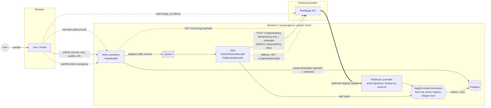

# SPEC: Pixelforge Studio

Task: `docs/TASK.md`. Provider reference: `docs/PIXELFORGE_API.md`. Rules for working on this repo: `CLAUDE.md`.

## Overview

Signed-in users write a prompt, pick an aspect ratio, a quality and up to 4 reference image URLs, see what it will
cost, and generate an image through Pixelforge. Generations are asynchronous: the app submits them from a queue,
learns the result from signed webhooks (with polling as a fallback) and shows live status in a history next to the
composer. Users pay Pixelforge's cost plus 25%. The estimate shown up front is a range; the actual charge is recorded
once, when the generation succeeds. Failed generations are free.

## Flow

1. **Request** (web): validate, recompute the estimate on the server, create the generation (`queued`, estimate,
   price table used), dispatch `SubmitGenerationJob` after commit, redirect to the page (`back()` until M4).
2. **Submit** (`SubmitGenerationJob` → `SubmitGeneration`): `POST /v1/generations` with `Idempotency-Key` and
   `metadata.generation_id` = our id. On 202, save the Pixelforge id, `rates` and `submitted_at` under the row lock
   (M3 then applies the returned object through `ApplyProviderGeneration` and dispatches `PollGenerationJob` with a
   45s delay). On 429/503, release with `Retry-After`. On a definitive error, mark `failed` ($0). On an uncertain
   outcome, keep retrying with the same key.
3. **Webhook** (`PixelforgeWebhookController`): verify the signature, record the event (unique event id), apply the
   generation object through `ApplyProviderGeneration`, answer 204. Duplicates answer 204 with no effect.
4. **Apply** (`ApplyProviderGeneration`): lock the row; ignore if already final; move the status forward; on
   `succeeded`, record usage, rates, provider cost and charge exactly once; on `failed`, record the error, charge $0.
5. **Poll** (`PollGenerationJob`): stop if already final; otherwise `GET /v1/generations/{id}` and apply it through the
   same Action; reschedule with growing delays until final or out of attempts.
6. **Display**: the page polls its own props (`generations`, `hasInProgress`) every 2.5s only while something is in
   progress.

## Architecture

Domain-oriented (*Laravel Beyond CRUD*) inside `app/`. See `CLAUDE.md` for the rules of each layer.



Legend: solid = main flow · dashed = fallback / read-only · bold = push from Pixelforge.

### Folder structure

```
app/
├── Domain/
│   ├── Generations/
│   │   ├── Actions/        CreateGeneration, SubmitGeneration, FailGeneration, ApplyProviderGeneration,
│   │   │                   RecordWebhookEvent
│   │   ├── Data/           GenerationRequestData, ProviderGenerationData, GenerationUsageData
│   │   ├── Enums/          GenerationStatus, GenerationFailureReason, ImageSize, ImageQuality
│   │   ├── Exceptions/
│   │   ├── Models/         Generation, WebhookEvent
│   │   └── QueryBuilders/  GenerationQueryBuilder
│   ├── Pricing/
│   │   ├── Actions/        GetPriceTable (cache + last-known fallback), InvalidatePriceTable
│   │   ├── Data/           PriceTableData, TokenRatesData, TokenCountsData, CostEstimateData
│   │   ├── Enums/          DisplayRounding
│   │   ├── Exceptions/     UnsupportedRatePrecision, PriceTableUnavailable
│   │   ├── ValueObjects/   Money
│   │   ├── Casts/          MoneyCast
│   │   └── PricingCalculator.php
│   ├── Credits/            (M6) Actions, Enums, Exceptions, Models, QueryBuilders
│   └── Reporting/          (M7) Actions, Data
├── Integrations/Pixelforge/
│   ├── PixelforgeApi.php           contract: pricing(), createGeneration(), retrieveGeneration(), usage() (M7)
│   ├── HttpPixelforgeClient.php
│   ├── WebhookSignature.php
│   └── Exceptions/                 PixelforgeRateLimited, PixelforgeOverloaded, PixelforgeRejected,
│                                   PixelforgeUnavailable
├── Http/
│   ├── Controllers/        GenerationController, GenerationEstimateController, PixelforgeWebhookController,
│   │                       (M6) CreditPurchaseController, (M7) Admin/ReportController
│   ├── Requests/           StoreGenerationRequest, EstimateGenerationRequest
│   ├── Resources/          GenerationResource, CostEstimateResource
│   └── ViewModels/         GenerationPageViewModel, (M7) AdminReportViewModel
└── Jobs/                   SubmitGenerationJob, PollGenerationJob
tests/Fakes/FakePixelforgeApi.php
```

Starter kit code (`app/Concerns`, `app/Actions/Fortify`, the settings controllers and requests) stays as it is and is
exempt from these folder rules.

## Decisions

### Product and UX

- One page, inspired by PromptEdit's own image tool: composer on the left, history on the right, dark theme. It
  replaces the starter kit's Dashboard as the page after login; the Dashboard goes away (M4).
- Aspect ratio 1:1 / 3:2 / 2:3 maps to `1024x1024` / `1536x1024` / `1024x1536`. Quality low / medium / high.
  The UI preselects 1:1 and medium; we always send both to Pixelforge. The UI does the aspect ratio mapping: our
  endpoints receive the Pixelforge size (`1024x1024`), validated by the `ImageSize` enum.
- Reference images are URLs (max 4, http/https), not uploads: Pixelforge never downloads them.
- Users can start several generations in a row; each appears at the top of the history as `queued`. No per-user
  in-flight limit (next steps).
- Estimate box: "**~$0.3929** · at most $0.4476", plus "The final cost depends on processing. Failed generations
  are free." Updated by a debounced (300 ms) call to the estimate endpoint; validation errors show inline instead.
- If no price table is available (never fetched and `/v1/pricing` fails), the estimate shows "Estimate unavailable"
  and Generate is disabled; the server rejects the request too.
- Estimate endpoint: `POST /generations/estimate`, signed-in users only, `estimate` throttle, the same validation as
  generating (prompt up to 4,000 Unicode characters, size, quality, up to 4 http/https URLs). It returns
  `data.min`, `data.typical` and `data.max`, each `{amount, display}`; with no price table it answers 503
  "Estimate unavailable".
- History card: prompt, size, quality, status badge, estimated and actual cost, the image, timestamps. A `queued`
  generation without `submitted_at` shows "Waiting to submit" (or "Retrying…"). Failed cards show a friendly
  reason and "You were not charged". After `image_url_expires_at` the image becomes an "Image expired" placeholder.
- Amounts show 4 decimals; the exact amount (9 decimals) is in a tooltip. Every amount the UI shows (estimates,
  history costs) is sent by the server as the exact value (9-decimal string) plus a formatted display value; the
  frontend never rounds. Display rounding: min down, typical half-up, max up, actual cost half-up (the exact value
  stays in the tooltip).
- Registration is open (no email verification, 2FA or passkeys). A seeded demo user exists and is an admin.

### Money

- Amounts are integer nanodollars (`bigint`) wrapped in `Money`. No floats anywhere. `Money` accepts negative
  amounts (M6 needs signed amounts); rounding up is always towards +∞.
- Provider cost = Σ tokens × rate (rates are USD per 1M tokens, so 1 token at $1.00/1M = 1,000 nanodollars).
- Rates become integer nanodollars per token at the edge (`"12.50"` → 12,500). A rate with more than 3 decimals
  can't be exact in nanodollars and throws `UnsupportedRatePrecision` instead of rounding.
- `text_token_variance` arrives as a JSON number (`0.15`); it becomes integer basis points (1,500) at the edge.
- Charge = provider cost × (100 + markup percent) / 100, rounded up to the nanodollar (at most $0.000000001 in our
  favor), on estimates and actual costs alike. Markup is 25% (`config/generations.php`). Failed generations:
  charge 0.
- Actual cost uses the `usage` and `rates` of the generation itself (fixed at creation), so it matches
  `GET /v1/usage`. Estimates use `GET /v1/pricing`.
- Estimate tokens:

  | Type | Min | Typical | Max |
  |---|---|---|---|
  | Text (`e = ceil(chars / 4)`, Unicode chars) | `floor(e × (10⁴ − v) / 10⁴)` | `e` | `ceil(e × (10⁴ + v) / 10⁴)` |
  | Image | 765 × refs | same | same |
  | Output | table[quality][size] | same | same |
  | Reasoning | range min | midpoint, rounded up | range max |

  `v` is the variance in basis points (1,500); every step is integer arithmetic. The 4 and the 765 come from the
  price table (`characters_per_text_token`, `per_reference_image`), not from constants.
- The generation stores the typical and max charge it showed, and the price table it used.
- Price table cache: TTL `PIXELFORGE_PRICING_CACHE_TTL` (default 3600 s). Invalidated when a create response returns
  rates different from the cached ones: M1 builds the invalidation, M2 calls it. The last table fetched is kept with
  no TTL as the fallback.

### Pixelforge

- Generation id: UUIDv7 (`HasUuids`), also used as `Idempotency-Key` and `metadata.generation_id`.
- HTTP client timeouts: 10 s to connect, 30 s per request.
- `SubmitGenerationJob`: `ShouldBeUnique` by generation id (`UniqueFor` 70 minutes, so a dead worker can't keep the
  lock), `retryUntil()` = creation + the uncertain-outcome window (60 minutes); the 10-minute submit window is checked
  inside the job. Released with the `Retry-After` header on 429/503; exponential backoff from 2 s capped at 60 s when
  the header is missing and after an uncertain outcome.
- Answers are classified as:
  - "Nothing was created": 429 `rate_limit_exceeded` / `concurrency_limit_exceeded`, 503 `overloaded`. Release.
  - Definitive: 400 `content_policy_violation`, 429 `daily_limit_exceeded`, 422 `validation_failed`, 409
    `idempotency_key_reused`, 401 `invalid_api_key`, and any other 4xx. `failed` at $0. Everything except the first
    two is logged as an error: it means a bug or a misconfiguration.
  - Uncertain: timeout, connection error, any 5xx other than `overloaded`, a 202 with an invalid body.
- Every answer other than a 202 increments `submit_attempts`. The first uncertain outcome sets
  `submission_uncertain_at`; from then on every non-202 answer is treated as uncertain until a 202 arrives (a 429
  after a timeout doesn't prove nothing was created).
- When the 10 minutes run out after "nothing was created" answers and no uncertain outcome, the generation is
  `failed` ($0) with our code `pixelforge_busy`.
- Uncertain outcomes keep retrying with the same `Idempotency-Key` (replays are free and don't count against the
  limits) for up to 1 hour, then the generation stays `queued`, an error is logged and the job stops. Never mark it
  `failed`: Pixelforge may have created and billed it.
- Failures store `error_code` (Pixelforge's code, or ours such as `pixelforge_busy`) and `error_message`
  (Pixelforge's original message, or a technical description for our codes), for debugging. No UI copy in the
  database: the friendly text comes from `GenerationFailureReason::fromCode($code)->message()`, applied by
  `GenerationResource` (M4). Content policy: "Prompt rejected by the content policy"; daily limit: "Daily capacity
  reached, try again after 00:00 UTC"; `pixelforge_busy`: "Pixelforge is busy. Please try again."; anything else: a
  generic message.
- The card derives its submission state from the columns: `submit_attempts` 0 → "Waiting to submit", more than 0 →
  "Retrying…", uncertain for longer than the uncertain-outcome window → "Taking longer than expected".
- No concurrency semaphore on our side: we rely on `concurrency_limit_exceeded` + `Retry-After: 5` (limits are per
  account and shared with the local key).
- `PollGenerationJob`: delays 45 s, 1, 2, 5, 10, 10, 10, 10 minutes (8 attempts). It stops as soon as the generation
  is final, releases on 429 and, when out of attempts, logs a warning and keeps the last status.
- Webhook route `POST /webhooks/pixelforge`: no auth, no CSRF, no throttle. Signature: HMAC-SHA256 of
  `"<t>.<raw body>"`, `hash_equals`, `|now - t| <= 300` s, otherwise 400. Event id unique in `webhook_events`
  (duplicate → 204, no effect). `ping` → 204. Unknown generation → 204 and a log line. The event insert and the
  state change happen in one transaction, inline (fast enough for the 10 s limit).
- Matching: by `metadata.generation_id` (works even when the webhook beats the create response), then by
  Pixelforge id.
- Status moves only forward: `queued → processing → succeeded | failed`, and `queued → succeeded | failed` is
  allowed (a `processing` event may be lost or late). Final states never change.
- `completed_at` comes from Pixelforge, not from when we received it (the report groups by UTC completion day).
- Images are not downloaded (the task allows them to expire).

### Credits (M6)

- New users start at $0.00 and see "Buy credits to start". "Buy credits" offers fixed packs of $5, $10 and $25 (a
  fake purchase). The demo user starts with $10.00.
- Creating a generation reserves its max estimated charge; success settles to the actual charge; failure releases
  the whole reservation. Generate is blocked when the available balance is below the max estimate.

### Infrastructure

- Local: Docker Compose (`app`, `worker` with `queue:listen`, `postgres:17`, `redis:8`); Vite runs on the host;
  webhooks reach the app through an ngrok static domain.
- Production: Laravel Cloud (Flex compute, Serverless Postgres 17 "Dev", Laravel Valkey Flex, managed queue). No
  scheduler: polling uses delayed jobs.
- Redis/Valkey holds cache, sessions, locks and rate limiters, with retry and backoff configured on the connection
  (Valkey can restart during maintenance). Queue: Redis locally, Cloud managed queue in production.
- Throttles (per user): generate 10/min, estimate 60/min (`GENERATION_REQUESTS_PER_MINUTE`,
  `GENERATION_ESTIMATES_PER_MINUTE`).
- CI: GitHub Actions runs the test suite on PostgreSQL 17 and the linters on every push.

### Configuration

Classes receive these values through their constructors (bound in a service provider); only the throttles have
environment variables.

- `config/services.php` → `pixelforge`: the provider connection only. `base_url`, `api_key`, `webhook_secret`,
  `pricing_cache_ttl` (from `PIXELFORGE_*`), `connect_timeout` 10 s and `timeout` 30 s.
- `config/generations.php`: our business rules. Markup percent (25), throttles (10 and 60 per minute), the submit
  retry window (10 minutes), the uncertain-outcome retry window (60 minutes) and the polling delays.

## Data model

All amounts are `bigint` nanodollars (cast to `Money`).

**users** (starter kit) + `is_admin` boolean, default false.

**generations**

| Column | Type | Notes |
|---|---|---|
| `id` | uuid, PK | UUIDv7; also the Idempotency-Key and `metadata.generation_id` |
| `user_id` | FK users, nullable | `nullOnDelete`: deleting an account keeps its costs for the report |
| `status` | string | `GenerationStatus` |
| `prompt` | text | |
| `size`, `quality` | string | enums |
| `reference_images` | jsonb | list of URLs |
| `estimate_price_table` | jsonb | price table used for the estimate |
| `estimated_charge`, `estimated_max_charge` | bigint | what the user saw |
| `pixelforge_id` | string, nullable, unique | `gen_…` |
| `rates` | jsonb, nullable | from Pixelforge, fixed at creation |
| `input_text_tokens`, `input_image_tokens`, `output_tokens`, `reasoning_tokens` | integer, nullable | on success |
| `provider_cost`, `charge` | bigint, nullable | set once on success; both 0 on failure |
| `image_url` | text, nullable | |
| `image_url_expires_at` | timestamp, nullable | |
| `error_code`, `error_message` | string / text, nullable | Pixelforge's code and message, or ours (no UI copy) |
| `submit_attempts` | integer, default 0 | answers other than a 202 |
| `submission_uncertain_at` | timestamp, nullable | first uncertain submit outcome |
| `submitted_at`, `started_at`, `completed_at` | timestamp, nullable | `completed_at` from Pixelforge |
| `created_at`, `updated_at` | timestamp | |

Indexes: `(user_id, created_at)`, `status`, `completed_at`.

**webhook_events**: `id`, `event_id` (unique), `type`, `generation_id` (nullable FK), `delivery_attempt`,
`payload` (jsonb), `created_at`.

**credit_transactions** (M6): `id`, `user_id`, `generation_id` (nullable), `type` (`purchase`, `reservation`,
`settlement`, `release`), `amount` (signed bigint), `created_at`. Balance = sum of `amount`.

## Milestones

Before M1: CI runs on PostgreSQL (`.github/workflows`), and this SPEC is approved.

**M1 – Money and pricing**
`Money` + `MoneyCast` + `DisplayRounding`, `PriceTableData`, `TokenRatesData`, `TokenCountsData`,
`CostEstimateData`, `UnsupportedRatePrecision`, `PricingCalculator`, `ImageSize` + `ImageQuality` enums,
`GenerationRequestData`, `PixelforgeApi::pricing()` + `HttpPixelforgeClient`, `GetPriceTable` (cache, fallback) +
`InvalidatePriceTable` + `PriceTableUnavailable`, `config/services.php` entry, `config/generations.php`, estimate
endpoint with its request, throttle and `CostEstimateResource` (exact + display values).
Tests: the docs' worked examples as expected values (max $0.373875000; usage day $0.169080000; the succeeded
lighthouse example $0.305510000), markup rounding, estimate ranges for each quality/size, Unicode prompt length,
rate precision, display rounding (min down, typical half-up, max up), cache hit/miss/fallback, 503 without a price
table, validation.
Manual: `POST /generations/estimate` returns min/typical/max for a sample prompt.

**M2 – Create and submit**
Migrations (`generations`, `webhook_events`, `users.is_admin`), `Generation` model + factory,
`GenerationStatus`, `GenerationFailureReason`, `CreateGeneration`, `GenerationController@store` (throttle, `back()`,
`estimate` validation error without a price table), `SubmitGenerationJob` + `SubmitGeneration` + `FailGeneration`,
`PixelforgeApi::createGeneration()`, error mapping, `FakePixelforgeApi`.
Tests: the estimate is recomputed and stored; the job is dispatched after commit; 202 stores the Pixelforge id, rates
and `submitted_at`; 429/503 release with `Retry-After`; each definitive error fails at $0; 10-minute cutoff; uncertain
outcomes keep retrying with the same key, also after a later 429 or definitive error; idempotent replay.
Manual: create one generation from tinker or a request; it appears in the Pixelforge dashboard with our metadata.

**M3 – Results: webhook and polling**
`WebhookSignature`, `PixelforgeWebhookController`, `RecordWebhookEvent`, `ApplyProviderGeneration`,
`PollGenerationJob`, `PixelforgeApi::retrieveGeneration()`.
Tests: valid / invalid / expired signature; duplicate event; `processing` after `succeeded`; webhook before the
create response; webhook and poll racing charge once; failed is free; polling stops when final and gives up without
failing.
Manual: through the tunnel, `[duplicate]`, `[fail]`, `[slow]` and a dashboard resend all end in the right state with
one charge.

**M4 – Page**
Before starting: check `usePoll` and partial reloads in the Inertia v3 docs.
`GenerationQueryBuilder` (`forUser()`, `inProgress()`), `GenerationPageViewModel` (lazy props), `GenerationResource`
(exact + display values for every amount, friendly failure text from `GenerationFailureReason`), the Vue page
(composer, estimate, history, cards, empty and error states), `usePoll`, Wayfinder routes, nav and branding. The
page becomes the page after login and the starter kit's Dashboard is removed.
Tests: page props for a user (only their generations, `hasInProgress`), partial reload returns only the requested
props.
Manual: every keyword (`[blocked]`, `[overloaded]`, `[fail]`, `[slow]`, `[duplicate]`, `[succeed]`) shows a clear
state; four generations at once show one waiting for a slot.

**M5 – Ship**
Redis retry/backoff config, demo user seeder, deploy to Laravel Cloud, keyword scenarios on production, compare the
recorded provider costs with `GET /v1/usage`, README, leave a few generations.
Manual: the production numbers match the Pixelforge dashboard for the production key.

**M6 – Stretch: balances**
`credit_transactions`, `PurchaseCredits`, `ReserveCredits` (in `CreateGeneration`, locking the user row),
`SettleCharge` / `ReleaseReservation` (in `ApplyProviderGeneration`), balance in the header and "Buy credits",
Generate blocked when the balance is below the max estimate.
Tests: reservation, settlement to the actual charge, release on failure, concurrent requests cannot overspend.

**M7 – Stretch: admin report**
Admin-only page (Gate on `is_admin`): per UTC completion day and per user, generations, credit spend (charges),
provider cost and profit, plus Pixelforge's `cost_usd` from `GET /v1/usage` for the same days, flagging any
difference.
Tests: grouping by completion day in UTC, totals, access control, comparison against a faked usage response.

## Optional / next steps

- "Check status" button on a generation whose polling gave up.
- Per-user limit on generations in progress.
- Download images to object storage to keep them after 24 hours.
- WebSockets (Reverb) instead of polling the page.
- A shared concurrency semaphore for Pixelforge's 3-slot limit.
- Alerts on failed jobs and on report mismatches (Sentry or Nightwatch).
